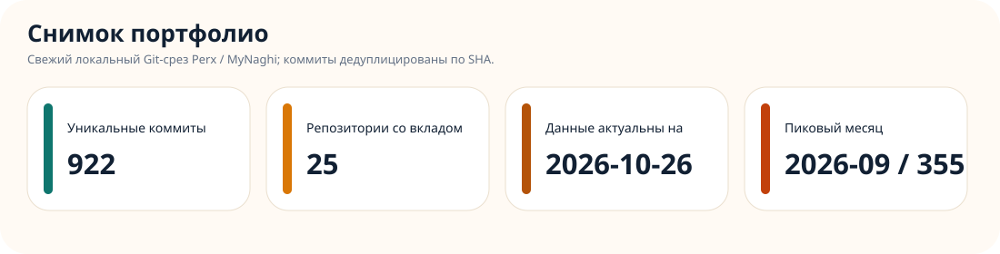
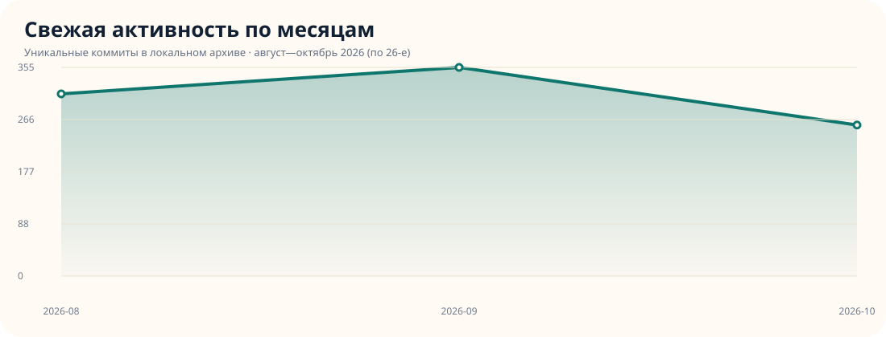
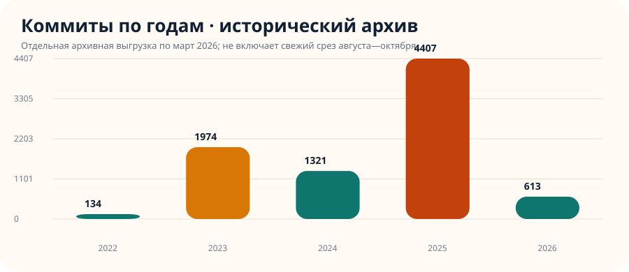
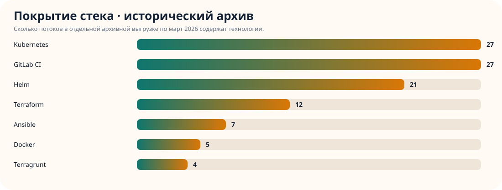
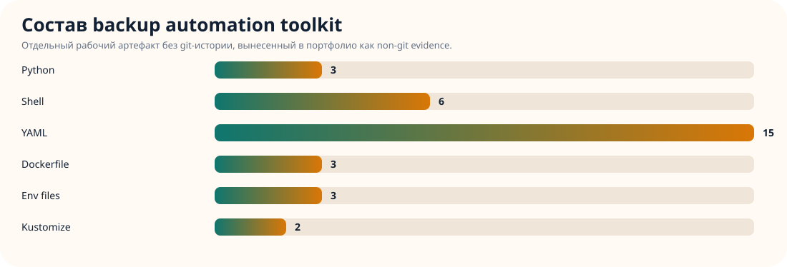

# Портфолио DevOps / Platform Engineer

Публичное портфолио с подтверждаемыми артефактами вместо приватного клиентского кода. Репозиторий собран на основе локального архива рабочих каталогов и показывает не только формулировки из резюме, но и реальный цифровой след: статистику по git-истории, графики активности, кейсы и воспроизводимый демо-стенд.

## Что здесь есть

- агрегированная статистика по рабочим git-репозиториям;
- графики по периодам, ключевым потокам и стеку;
- краткие кейсы по platform engineering / DevOps задачам;
- публичный демо-проект, который можно локально поднять и проверить.

## Быстрый старт для просмотра

- [Лендинг портфолио](index.html)
- [Ключевые выводы](docs/HIGHLIGHTS.md)
- [Сводка активности](docs/ACTIVITY_SUMMARY.md)
- [Активность за август–октябрь 2026](docs/ACTIVITY_2026.md)
- [Кейсы](docs/CASE_STUDIES.md)
- [Публичные демо-проекты](docs/PUBLIC_PROJECTS.md)
- [Дополнительные артефакты](docs/ARTIFACT_EVIDENCE.md)
- [VPS VPN-сервер](artifacts/vps-vpn-server/README.md)
- [VPN Telegram Admin Bot](artifacts/vpn-telegram-admin-bot/README.md)
- [Сопоставление резюме и портфолио](docs/RESUME_PORTFOLIO_MAP.md)
- [Краткое описание](docs/APPLICATION_BLURB.md)
- [JSON со статистикой](data/commit_summary.json)
- [JSON с обезличенной сводкой за 2026 год](data/perx_commit_summary.json)
- [Снимок активности в приватном GitLab](data/gitlab_activity_2026.json)

## Локальный просмотр и публикация

Сайт статический и публикуется GitHub Pages из ветки `gh-pages`. Главная страница поддерживает четыре сценария через параметр `?view=`: `hr`, `tech`, `interview`, `ai`. Выбор сохраняется локально в браузере.

CSS и JavaScript главной страницы подключены с версией в URL. Это обязательно при изменении интерфейса: GitHub Pages и браузер не должны отдавать старый кеш поверх новой разметки.

Для локального просмотра из корня репозитория:

```bash
python3 -m http.server 8000
```

Затем откройте `http://localhost:8000/`. Главная страница генерируется командой `python3 scripts/build_portfolio.py`; она читает локальный архив рабочих репозиториев, поэтому перед пересборкой проверьте пути `SOURCE_ROOT`, `BACKUP_ARTIFACT_ROOT` и `SKILLS_MATRIX_PATH` в окружении или в самом скрипте. Сводка нового архива обновляется отдельно: `python3 scripts/build_perx_summary.py /Users/macbook/Documents/perx`. В публичный JSON попадают только агрегаты, не названия приватных репозиториев, сообщения коммитов или исходный код.

Перед коммитом:

```bash
python3 scripts/check_site.py
node --check assets/site.js
```

Эти же проверки автоматически запускаются GitHub Actions для ветки `gh-pages` и pull request.

## Уже подтверждено по текущей выгрузке

- Свежий срез Perx / MyNaghi за `2026-08-07` -> `2026-10-26`: `922` уникальных коммита после дедупликации по SHA в `25` репозиториях с авторским вкладом; по месяцам `310 / 355 / 257`.
- Историческая выгрузка содержит `8449` появлений авторских коммитов в `49` рабочих потоках за период `2023-09` -> `2026-03`. Она считалась по репозиториям и не дедуплицировалась между копиями.
- Эти источники не объединяются в общий итог: у них разные методики, а активность за `2026-04` -> `2026-07` в доступных данных не покрыта. На графике свежий срез показан отдельно, разрыв не трактуется как отсутствие работы.
- На `2026-10-27` приватный GitLab показывал `210` созданных и `183` объединённых merge requests автора. Это снимок интерфейса GitLab, не публично проверяемая метрика и не оценка качества работы.
- Наиболее заметный стек по исторической выгрузке: `Kubernetes`, `Helm`, `Terraform`, `Ansible`, `GitLab CI`, `FluxCD / GitOps`; свежие темы Perx / MyNaghi описаны отдельно в кейсах за 2026 год.

Важно:

- Статистика строится только по тем каталогам, где локально сохранилась читаемая git-история.
- Часть более ранних рабочих копий, включая некоторые архивы `swapp` и `eusy`, в текущей выгрузке содержит неполные `.git`-структуры, поэтому ранние периоды могут быть недопредставлены в графиках.
- Отдельные рабочие артефакты без git-истории вынесены в специальный раздел `Дополнительные артефакты`, чтобы не смешивать non-git evidence с commit-метриками.

## Графики











## Публичный демо-проект

- [platform-engineering-demo](projects/platform-engineering-demo/README.md) — демонстрационный стенд внутри портфолио: `Terraform + Kubernetes + GitHub Actions + Prometheus/Grafana/Loki`. Прогнан локально end-to-end через `kind`, deployment и smoke-test.
- [VPN Telegram Admin Bot](artifacts/vpn-telegram-admin-bot/README.md) — redacted личный VPS-контур: закрытый доступ родственников, персональные бессрочные VLESS-профили, QR для Happ, systemd и ограниченный helper для Xray.

## Кратко

DevOps / Platform Engineer. В дополнение к резюме приложено GitHub-портфолио с подтверждаемыми артефактами по Kubernetes, Terraform, GitOps, CI/CD и observability: агрегированная статистика по рабочим git-репозиториям, кейсы и публичный демо-проект, который можно локально воспроизвести.
